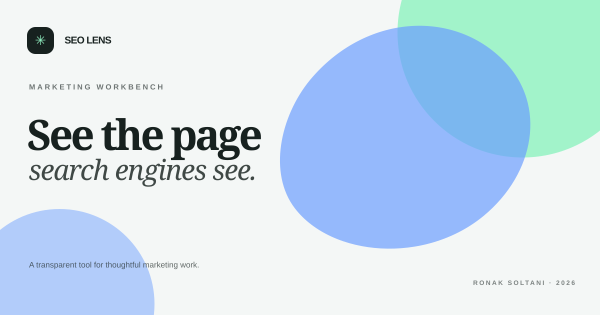

# SEO Lens

> TECHNICAL SEO · LOCAL-FIRST

A privacy-first on-page audit. Paste HTML, get a readable checklist, and fix the issues that matter first.

A complete, dependency-free portfolio project by **Ronak Soltani**. This repository contains runnable source code, a product brief, usage notes and an original social preview.

## Project at a glance

- **Track:** Digital marketing and SEO workbench
- **Status:** Portfolio concept, version 1.0
- **Stack:** semantic HTML, modern CSS and vanilla JavaScript
- **Dependencies:** none
- **Network requests from the app:** none

## Run it locally

1. Clone or download this repository.
2. Open `index.html` in a modern browser.
3. If your browser restricts local file features, run `python -m http.server 8000` from this folder and open `http://localhost:8000`.

No package installation or build step is required.

## What you can explore

- Audit pasted HTML locally with eight explainable checks.
- Responsive layout, semantic landmarks, keyboard focus styles and reduced-motion support.
- Original interface artwork made with CSS; `preview.svg` is also used as the project icon.
- Copy and file-export controls where the browser supports them.

## How it works

DOMParser checks title, description, H1 count, image alt attributes, canonical URL, language, viewport and noindex directives; findings are prioritized and scored as checklist coverage.

## Design and engineering notes

Keep source local, explain each check and label the score as coverage rather than a ranking prediction.

## Privacy and data scope

This is a static, front-end project. The application code makes no analytics, API or server requests. Pasted text, selected CSV/XML files and demo preferences are processed in the browser. Saved preferences use this browser profile’s local storage when applicable. No account or backend is included.

Demo data is illustrative. Review the input source, definitions and assumptions before using any result in business decisions.

## Scope and limitations

No crawling, rendering, schema analysis or search-engine ranking assessment; HTML parsing is heuristic.

Read [PROJECT-PLAN.md](PROJECT-PLAN.md) for the audience, interaction flow, design rationale and next iteration.

## Project files

- `index.html` — page structure, content and accessible controls.
- `styles.css` — layout, responsive states, color system and original CSS artwork.
- `app.js` — project-specific interaction logic and browser-local utilities.
- `preview.svg` — original social-preview graphic and SVG favicon.
- `PROJECT-PLAN.md` — product brief, decisions, boundaries and roadmap.
- `CONTRIBUTING.md` — lightweight contribution guidance.
- `.editorconfig` and `.gitignore` — editor consistency and generated-file exclusions.

## Accessibility

The interface includes a skip link, landmark structure, labelled controls, visible keyboard focus and reduced-motion handling. This is a starting point, not a substitute for assistive-technology testing with real users.

## License

Released under the MIT License. See [LICENSE](LICENSE).
